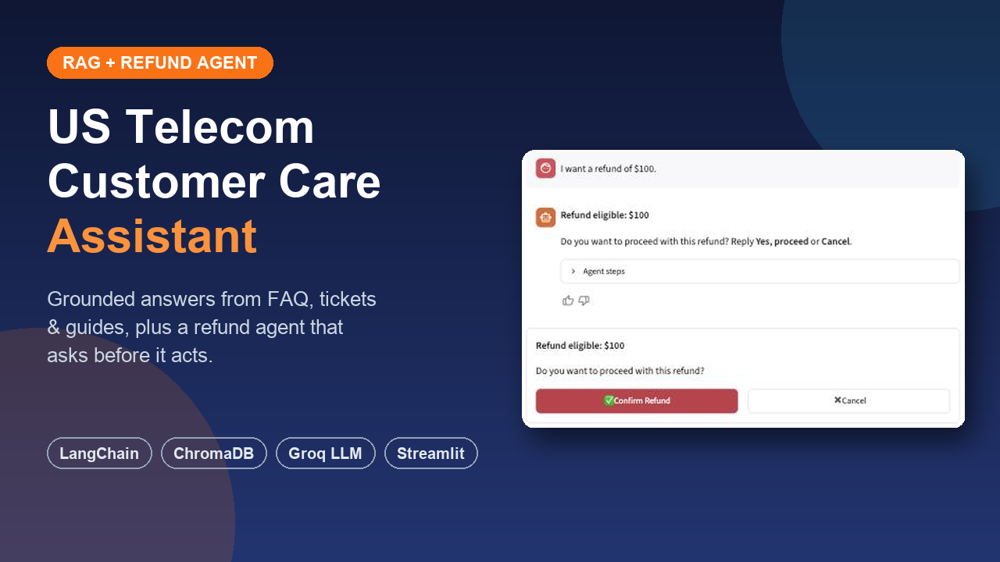
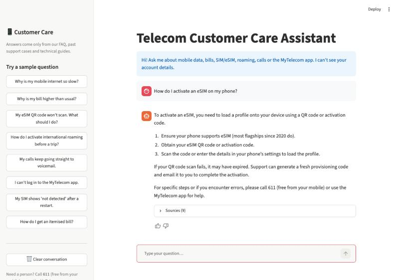
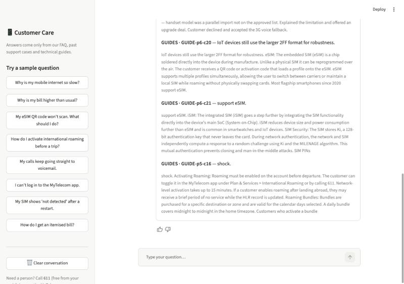
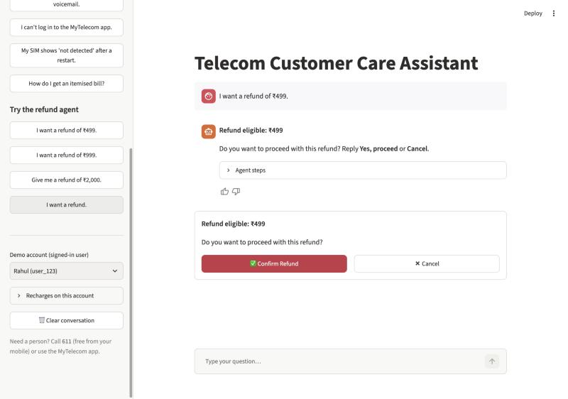
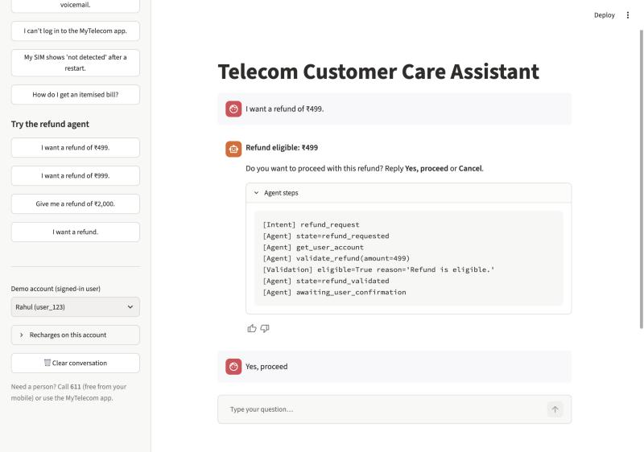

# Telecom Customer Care Assistant (RAG Chatbot)

## Short info
An AI support chatbot that answers Tier-1 telecom questions (mobile data, bills, SIM/eSIM, roaming,
calls, the MyTelecom app) using **only** the company's own knowledge: the FAQ, past resolved
support tickets and the technical PDF guide. Every answer shows its sources.

## Project description
Customer care teams get the same questions again and again, and generic LLM chatbots make up
answers. This project uses Retrieval-Augmented Generation (RAG) so the bot only answers from
approved content.

- **Retrieve:** each question searches three ChromaDB collections in parallel (FAQ, tickets,
  guides) and takes the top 3 matches from each.
- **Generate:** an LLM on Groq (temperature 0) writes the answer from that context only. If the
  context isn't enough, it says so and points the customer to 611 or the MyTelecom app.
- **Trust:** answers stream token by token, and a **Sources** panel lists all 9 retrieved documents.
- **Feedback loop:** 👍 / 👎 ratings, questions, answers, sources and latency are logged for
  support ops to review.
- **Easy upkeep:** support ops edit the FAQ CSV, tickets DB or PDF and re-run one ingest script.

**Stack:** Python · LangChain · ChromaDB · all-MiniLM-L6-v2 embeddings · Groq LLM · Streamlit

## Links
- **Code:** https://github.com/rashmiaurora06-ai/RAGchatbot
- **Live app:** _add your Streamlit Cloud URL here_
- **Run locally:** `.venv/bin/streamlit run app.py` → http://localhost:8501

## How the chat works
1. Pick a sample question in the sidebar or type your own.
2. The bot answers in plain steps, grounded in the knowledge base.

3. Open **Sources (9)** to see exactly which FAQ entries, tickets and guide sections were used,
   then rate the answer with 👍 / 👎.

## How the refund agent works
1. Ask for a refund, e.g. "I want a refund of ₹499." The agent looks up the account, checks the
   refund rules in code, and shows a Confirm Refund / Cancel card for amounts of ₹499 or less.

2. Open **Agent steps** to see every tool call and the validation result. Nothing is refunded
   until you confirm. Amounts above ₹499 go to the Support Team for review instead.

